I'm 15 and I live in Athens. I build AI software and web products end to end, and I invest in the companies building the AI stack.


**Now:** starting my next company, in AI security · open-sourcing the tools I built along the way.

---

### Net Worth Tracker: one number for everything I own

[](https://github.com/geo0apostolakis/networth-tracker)
[](https://github.com/geo0apostolakis/networth-tracker)
[](https://github.com/geo0apostolakis/networth-tracker/blob/main/LICENSE)

The dashboard I run my own money on. Bank, broker, cash and crypto each stay in their own currency and are converted with live FX into one net-worth line.

- Syncs on its own: Revolut over Open Banking (Enable Banking, 90-day consent, the bank is asked at most every 4 hours), broker positions over the Freedom24 API, and watch-only wallets read from public RPCs on Bitcoin, Solana and eight EVM chains. Nothing in it holds a key that can move money.
- The whole state is one JSON row in Postgres. Every write carries a state version, so a tab still open on an older build gets a 409 instead of overwriting a newer save.
- The PDF statement a card app exports is parsed into a ledger, and merchant rules sort it into spending categories. A hand edit always beats a rule.
- A wallet map pulls every transfer and drops the spam: zero-value moves, fake tickers, and address poisoning, caught as any counterparty that shares the first four and last four hex characters with one of your own wallets.
- Two auth layers. The proxy only redirects; every API route checks the session again by itself. Login is a passkey or a password, ten wrong passwords in 15 minutes close password sign-in, and both tables run RLS with no policies, so a leaked anon key reads nothing.
- It is single-user by design, one deployment per person. There is no test suite yet.

**[Source](https://github.com/geo0apostolakis/networth-tracker)**

---

### PDF to Word: same pages, working links

[](https://pdf-to-word-pages.vercel.app)
[](https://github.com/geo0apostolakis/pdf-to-word)
[](https://github.com/geo0apostolakis/pdf-to-word/blob/main/LICENSE)

Converters that make a PDF "editable" rebuild the layout and break it. This one keeps every page exactly as it was, inside a `.docx`, with the links still clickable.

- pdf.js draws each page at 200 DPI onto a Word page of the same size, so nothing reflows.
- Every link box gets a transparent picture on the same spot that carries the link: web, mail, or a jump to another page as a bookmark. The link's words are cut out of the page image and written back as real text in a see-through text box, with letter spacing tuned so the line keeps the PDF's width.
- Apple Mail's preview adds about 5.4 pt under each page and positions floating objects from the top of their section. So every page is its own section, the inline picture is 5.4 pt shorter, and a full-size copy of the same image floats on top. Word and Apple line up exactly, at no extra bytes.
- HTML pages and slide decks go through the same path. Nothing in a dropped file runs: scripts, handlers, `javascript:` links, `<base>`, meta refresh, objects and frames are stripped, and the hidden render frames allow only `data:` images and fonts.
- One 1.5 MB HTML file, offline, nothing leaves the browser. About 1,100 lines of my own JavaScript on top of pdf.js and JSZip.
- Not supported: PPTX, which a browser cannot draw faithfully. Gmail, Google Docs and Outlook are untested.

**[Try it](https://pdf-to-word-pages.vercel.app)** · **[Source](https://github.com/geo0apostolakis/pdf-to-word)**

---

### redate: new dates, same file

[](https://imerominies.vercel.app)
[](https://github.com/geo0apostolakis/redate)
[](https://github.com/geo0apostolakis/redate/blob/main/LICENSE)

Change every date in a Word file or a PDF and get the same file back, with the fonts and layout intact and every other byte untouched.

- Word often splits one date across several `<w:t>` runs (`15 Οκτ` + `ωβρίου 2026`). redate joins each paragraph's runs, finds the dates in the joined text, and edits only the characters inside those runs. It covers the body, tables, headers, footers, footnotes and text boxes.
- In a PDF it executes each page's drawing commands to find where every character lands, rebuilds the lines, finds the dates, then removes each one from the commands that drew it and writes the new one in its place.
- The new date uses the original font when that font already has every glyph needed. If not, it uses a metric-compatible twin (Arimo for Arial, Tinos for Times, Carlito for Calibri) so the widths match, and the rest of the line moves the way Word would move right-aligned, centred or justified text.
- The change is appended as an incremental update, so every original byte of the PDF is still in the file.
- pdf-lib's font subsetting drew most letters blank in macOS Preview, so redate ships its own TrueType subsetter. It empties unused glyphs instead of removing them, which keeps glyph ids stable under `Identity-H`.
- Writes the new date in the old one's style: `15/10/2026`, `15.10.26`, `Thursday, 15 October 2026`, Greek month names. About 2,800 lines, 15 tests on `node:test`. The live app's interface is in Greek.

**[Try it](https://imerominies.vercel.app)** · **[Source](https://github.com/geo0apostolakis/redate)**

---

### Handoff: send a tokenized stock to a GitHub or X handle

[](https://github.com/geo0apostolakis/handoff)
[](https://github.com/geo0apostolakis/handoff)
[](https://github.com/geo0apostolakis/handoff/blob/main/LICENSE)

Type a handle, pick a stock, send. The recipient needs no account, no seed phrase, and may not know the app exists.

- On send, the server pregenerates a wallet for the recipient through Privy's API. Whenever they sign in with that GitHub or X account, the wallet is already theirs, with no claim transaction.
- Wallets are bound to the platform's permanent numeric user id, never to the handle. `@torvalds` can be renamed or sold; GitHub user `1024025` cannot. A `unique (platform, platform_user_id)` constraint in the schema enforces it.
- The sender never logs in or signs anything through the app. The server reads the recipient wallet's balance as a baseline, returns the address and a QR code, and credits the send once the on-chain balance delta covers the amount.
- The price of no sender login is written in the README: the app cannot know who paid, and two identical requests share one deposit address and race for it.
- X handles resolve through the official API when a token is set, otherwise through a public mirror. The resolver refuses unless the screen name that comes back matches the one asked for and the id is numeric.

**[Source](https://github.com/geo0apostolakis/handoff)**

---

### SAC Capital: AI agents that trade US stocks (hackathon, team of three)

[](https://github.com/nikolas-sapa/sac-capital)
[](https://github.com/nikolas-sapa/sac-capital)
[](https://sapa-fund.vercel.app)

Built for the AI Alpha & Data track with [Nikolas Sapalidis](https://github.com/nikolas-sapa) (lead developer) and Ilias Konstantakopoulos (safety features and stock research). My part: I funded the project, including its on-chain deployment, and worked on the investment strategy and the build decisions with the team.

- Claude agents trade with no human in the loop: an event screen, a Haiku pre-filter, a Sonnet bull case, a second Sonnet arguing against it, then an auditor.
- A risk kernel sizes every position at quarter Kelly, with caps of 25% per name and 35% per sector, a correlation gate on 90 days of real returns, a 5% daily loss halt and a 15% drawdown breaker. New entries are blocked from 24 hours before to 2 hours after FOMC, CPI and NFP releases, while exits stay allowed.
- Each decision is serialised as canonical JSON, hashed with SHA-256 to a `bytes32` and recorded on Mantle. The dashboard recomputes the hash in the browser, so anyone can check that the on-chain record matches what the AI decided.
- Paper trading only. A live order is refused unless three separate switches are all set.
- In week six the six open positions were up about $3,980 combined on a $100k paper account, five of them green. That is paper money, and the biggest percentage winners were on positions of about $5.

**[Live](https://sapa-fund.vercel.app)** · **[Source](https://github.com/nikolas-sapa/sac-capital)**

---

```text
$ cat how-i-build.txt
  agents   Claude Code with my own skills; several agents on one repo in parallel
  verify   tests and end-to-end checks against the real APIs before I call it done
  ship     Next.js, Supabase and Vercel; idea to live product in days
  before   a year running an AI automation agency, closed in Oct 2026 to build my own
```

### Links

[georgeapostolakis.com](https://georgeapostolakis.com) · [X @Apostolakis_Geo](https://x.com/Apostolakis_Geo) · [LinkedIn](https://www.linkedin.com/in/apostolakis-george)
